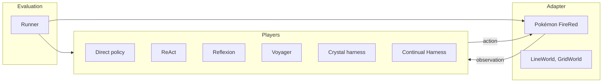

# Porygon

Porygon is an open-source framework for developing and comparing autonomous players on long-horizon games. The game is Pokémon FireRed. One player is an open-weights model that sees only the current snapshot and chooses an action. The others are [ReAct](https://arxiv.org/abs/2210.03629), [Reflexion](https://arxiv.org/abs/2303.11366), [Voyager](https://voyager.minedojo.org/), a game-agnostic rebuild of the harness from [Teaching a Local LLM to Play Pokémon Crystal](https://projects.playtesting.dev/posts/pokemon-crystal/), and [Continual Harness](https://arxiv.org/abs/2605.09998).

The question is how those architectures change an agent's ability to explore, plan, remember, recover from mistakes, and carry out long action sequences — and which of those mechanisms still help when the game changes. The open-weights player is the floor: the same model, the same snapshot, and a decision with no carried context.

## Design

Game code, agent code, and experiment code stay separate. A new game is a new adapter. A new architecture is a new agent. Both meet at the same evaluation loop.



### Adapter

The adapter is the only Pokémon-specific code. It owns the emulator, the action space, and saved state. Everything else sees a snapshot.

- `reset()` — start or restore a known state
- `observe()` — return the current snapshot
- `step(action)` — apply one action and return the next snapshot
- `get_progress()` — return progression read from the game

A snapshot is visual (the screen), structured (party, position, battle, inventory, flags, and similar fields read from emulator memory), or both. Those are different experimental conditions, and every run records which one it used.

A goal is an input to the agent. Whether the goal was met is decided from adapter state. The model's own claim does not count.

This split follows the adapter in [Teaching a Local LLM to Play Pokémon Crystal](https://projects.playtesting.dev/posts/pokemon-crystal/): the game lives in one place, and the rest of the system consumes a clean snapshot. FireRed is a Game Boy Advance game, so it does not share that project's emulator.

### Agents

Players are interchangeable. They receive observations and return actions. They do not talk to the emulator. The model behind a player is configurable, including an open-weights model served locally.

**Direct policy.** An open-weights model maps the current snapshot onto one legal action. The call carries that snapshot and the action set. It carries no earlier turns, reflections, skills, or curriculum. Thinking and other hidden reasoning stay off, so the output is the decision itself. This is the player a typed-decision model also fits: one forward pass, a choice among the actions, no generated trace.

**ReAct.** Reason about the current situation, act, observe, and repeat. This is the agent baseline the direct policy is compared with.

**Reflexion.** ReAct plus a verbal review after each failed trial. The review is stored as text that later decisions can read.

**Voyager.** The lifelong-learning loop from Voyager, retargeted at this environment:

- An **automatic curriculum** proposes the next goal from the agent's progress and state.
- A **skill library** stores behaviors, retrieves them in similar situations, and composes them.
- **Iterative prompting** revises a skill using environment feedback, execution errors, and self-verification against the game.

Voyager's original action space is code, because Minecraft skills are open-ended programs. Pokémon's actions are a closed controller and menu language. The curriculum, library, and feedback loop are the part being adapted. A skill here is a short program over the legal actions (presses, fixed repeats, `until` loops on snapshot fields, and calls to other skills), and each press is one counted environment step. With `"skill_parameters": true` a skill is a parameterized API ([SkillWeaver](https://arxiv.org/abs/2504.07079)): `skill walk_through door` declares a parameter, `go_to $door` or `until map != $start_map (max 10):` uses it, and `call walk_through door_0` binds it by position, so one skill serves any target. With `"test_skills": true` a new parameterized skill enters the library as a candidate and becomes verified only after it succeeds again with different arguments, because an agent cannot restore game state to test in a sandbox as SkillWeaver does. Both are off by default; grammar and deviations are in [`agents/voyager/skills.py`](agents/voyager/skills.py) and [`agents/voyager/player.py`](agents/voyager/player.py).

**Crystal harness.** The harness from the Crystal write-up, rebuilt so it never names the game. It reads a *role snapshot* ([`environments/roles.py`](environments/roles.py)): doors, people, items, and milestones by role, plus a collision grid, the dialogue text, and the battle options. Each decision is routed by what the game is waiting for. A battle specialist removes options that break its rules (no move with no uses left, no knockout of something being caught) and the model picks from what is left. Dialogue is read into a journal as leads. The planner names a tool (`go_to`, `talk_to`, `press`, `note`) and code walks the path press by press. A stuck ladder escalates when the same situation repeats: show past failures, nudge, think more, then ask for help. A knowledge graph keeps a fixed backbone and lets the agent attach notes. The write-up publishes no prompts or thresholds, so those are ours. Its operator console is not built.

**Continual Harness.** One model plays through a minimal interface, the snapshot and the legal buttons, with a harness that starts empty: a guidance section, a skill library, and a memory. On a code-driven schedule (nothing before step 25, every 25 steps through step 200, then every 100) the same model, acting as a text-only Refiner, reads the last 50 steps and edits that harness in place, mid-trial, one pass each for guidance, skills, and memory. The agent can also write memory and ask for a refinement itself, rate-limited. The paper finds most of the gain comes from the skill library, so every pass is a switch and "skills only" is a config. Skills are programs in Voyager's skill language, not Python, so each press is a counted step, and a Refiner-written skill that does not parse against the legal actions is rejected and logged. A reply that is not a valid tool call is shown back to the model with the reason. A trial starts from an empty harness unless `carry_across_trials` is on. With `"skill_parameters": true`, `run_skill` takes `args` and a Refiner-written skill may declare parameters, which here stand where a JSON value goes, since this player has no `go_to`. Sub-agents are not built, and the Refiner can be a different model from the player. Ported from the authors' MIT-licensed code, with the deviations listed in [`agents/continual/player.py`](agents/continual/player.py).

### Evaluation

A result is a set of repeated trials under one declared configuration: the same initial state, model, action space, observation access, and computational budget.

The runner records task success, game progression, environment steps, token usage and cost, recovery from mistakes, skill reuse on later tasks, and consistency across trials. Ablations turn one mechanism off at a time — the curriculum, the skill library, verbal reflections, self-verification, or one of the Continual Harness refinement passes — and share the runner.

Trajectories, prompts, and model calls are saved with the run, along with a SHA-256 of every file the run starts from (ROM, saved state, agent memory files).

Two toy environments, LineWorld and GridWorld, implement the same interface with no emulator. Every architecture runs on them under the same budgets, so a player can be checked before it touches the game.

## Running

An experiment is a JSON config in [`experiments/`](experiments/): environment, agent and its mechanisms, model, goal, budgets, and trial count. Runs go to `runs/`, which is gitignored.

Agents are zero-shot by default. An agent block with `"examples": "<path>"` adds few-shot examples from a JSON file (format in [`agents/examples.py`](agents/examples.py)), and each agent reports `few_shot` in its mechanisms. ReAct and Reflexion also take `"retry_illegal_action": true`, which retries an action that is not legal; off, only a missing action is retried, as in the ReAct paper.

ReAct, Reflexion, and Voyager also take two switches that separate the architecture from the action interface. `"action_interface": "tools"` swaps one-button actions for the Crystal harness's tools: ReAct's Action line becomes a tool call (`go_to door_0`, `talk_to person`, `press A x3`), and Voyager's skill language gains `go_to` and `talk_to`. Code expands each call into presses, and the runner counts and logs every one, so steps stay comparable with button-only runs. `"specialists": true` (tools only) lets code handle busy screens, dialogue, and battles before the model is asked, as the harness does. Both are reported in `mechanisms`, and both are off by default, which keeps the button-only prompts exactly as they were.

```sh
uv run python -m experiments.run experiments/gridworld_react.json
uv run python -m evaluation.trace runs/<run> --trial 0
uv run python -m evaluation.results runs/*   # one row per run: success, and presses, frames, calls, tokens to the goal
```

The trace viewer prints each press beside the agent's reasoning and the progress that followed, so a claim like "I reached the stairs" sits next to the position that confirms or contradicts it.

## Setup

Python 3.12+ and [uv](https://docs.astral.sh/uv/). The FireRed adapter runs mGBA in process through its Python bindings, which are built from source. You supply your own ROM; it is never committed (`roms/` and `saves/` are gitignored).

```sh
brew install cmake pkgconf libzip libpng sqlite ffmpeg
uv sync --group dev --group emulator

git clone https://github.com/mgba-emu/mgba ~/src/mgba
cd ~/src/mgba && mkdir build && cd build
cmake .. -DBUILD_PYTHON=ON -DBUILD_QT=OFF -DBUILD_SDL=OFF -DENABLE_SCRIPTING=OFF \
  -DCMAKE_BUILD_TYPE=Release -DCMAKE_POLICY_DEFAULT_CMP0148=OLD \
  -DPYTHON_EXECUTABLE=/path/to/porygon/.venv/bin/python
make -j
```

The bindings' generated headers must see the same feature defines the library was compiled with, or `struct mCore` disagrees between the two and the core crashes on load. Rebuild them with those defines:

```sh
cd ~/src/mgba/src/platform/python
DEFS=$(grep C_DEFINES ~/src/mgba/build/CMakeFiles/mgba.dir/flags.make | tr ' ' '\n' | grep '^-D' | grep -v -e MGBA_DLL -e mgba_EXPORTS | tr '\n' ' ')
INCS=$(grep C_INCLUDES ~/src/mgba/build/python/CMakeFiles/mgba-pylib.dir/flags.make | sed 's/^C_INCLUDES = //')
BINDIR=~/src/mgba/build LIBDIR=~/src/mgba/build CPPFLAGS="$INCS $DEFS" \
  /path/to/porygon/.venv/bin/python setup.py build -b ~/src/mgba/build/python
```

Then put the built package on the venv's path and run the tests, including the ones against your ROM:

```sh
ls -d ~/src/mgba/build/python/lib.* > .venv/lib/python3.*/site-packages/mgba-local.pth
uv run --group dev pytest
PORYGON_ROM=roms/firered.gba PORYGON_STATE=saves/start.state uv run --group dev pytest tests/test_firered_rom.py
# optional: a state saved inside a battle enables the battle-context test
PORYGON_BATTLE_STATE=saves/battle.state
```

## Prior work

- [Voyager: An Open-Ended Embodied Agent with Large Language Models](https://voyager.minedojo.org/)
- [ReAct: Synergizing Reasoning and Acting in Language Models](https://arxiv.org/abs/2210.03629)
- [Reflexion: Language Agents with Verbal Reinforcement Learning](https://arxiv.org/abs/2303.11366)
- [Teaching a Local LLM to Play Pokémon Crystal on a DGX Spark](https://projects.playtesting.dev/posts/pokemon-crystal/)
- [Continual Harness](https://arxiv.org/abs/2605.09998) ([code](https://github.com/sethkarten/continual-harness))

Implementation boundaries for contributors are in [AGENTS.md](AGENTS.md).
