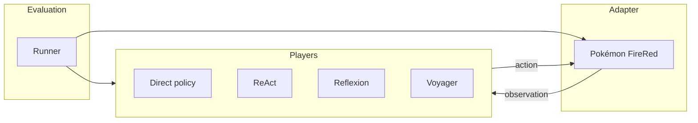

# Porygon

Porygon is an open-source framework for developing and comparing autonomous players on long-horizon games. The game is Pokémon FireRed. One player is an open-weights model that sees only the current snapshot and chooses an action. The others are [ReAct](https://arxiv.org/abs/2210.03629), [Reflexion](https://arxiv.org/abs/2303.11366), and [Voyager](https://voyager.minedojo.org/).

The question is how those architectures change an agent's ability to explore, plan, remember, recover from mistakes, and carry out long action sequences — and which of those mechanisms still help when the game changes. The open-weights player is the floor: the same model, the same snapshot, and a decision with no carried context.

## Design

Game code, agent code, and experiment code stay separate. A new game is a new adapter. A new architecture is a new agent. Both meet at the same evaluation loop.



### Adapter

The adapter is the only Pokémon-specific code. It owns the emulator, the action space, and saved state. Everything else sees a snapshot.

- `reset()` — start or restore a known state
- `observe()` — return the current snapshot
- `step(action)` — apply one action and return the next snapshot
- `get_progress()` — return progression read from the game

A snapshot is visual (the screen), structured (party, position, battle, inventory, flags, and similar fields read from emulator memory), or both. Those are different experimental conditions, and every run records which one it used.

A goal is an input to the agent. Whether the goal was met is decided from adapter state. The model's own claim does not count.

This split follows the adapter in [Teaching a Local LLM to Play Pokémon Crystal](https://projects.playtesting.dev/posts/pokemon-crystal/): the game lives in one place, and the rest of the system consumes a clean snapshot. FireRed is a Game Boy Advance game, so it does not share that project's emulator.

### Agents

Players are interchangeable. They receive observations and return actions. They do not talk to the emulator. The model behind a player is configurable, including an open-weights model served locally.

**Direct policy.** An open-weights model maps the current snapshot onto one legal action. The call carries that snapshot and the action set. It carries no earlier turns, reflections, skills, or curriculum. Thinking and other hidden reasoning stay off, so the output is the decision itself. This is the player a typed-decision model also fits: one forward pass, a choice among the actions, no generated trace.

**ReAct.** Reason about the current situation, act, observe, and repeat. This is the agent baseline the direct policy is compared with.

**Reflexion.** ReAct plus periodic review of failures. The review is stored as text that later decisions can read.

**Voyager.** The lifelong-learning loop from Voyager, retargeted at this environment:

- An **automatic curriculum** proposes the next goal from the agent's progress and state.
- A **skill library** stores behaviors, retrieves them in similar situations, and composes them.
- **Iterative prompting** revises a skill using environment feedback, execution errors, and self-verification against the game.

Voyager's original action space is code, because Minecraft skills are open-ended programs. Pokémon's actions are a closed controller and menu language. The curriculum, library, and feedback loop are the part being adapted. The skill representation is whatever this game can actually execute and reuse.

### Evaluation

A result is a set of repeated trials under one declared configuration: the same initial state, model, action space, observation access, and computational budget.

The runner records task success, game progression, environment steps, token usage and cost, recovery from mistakes, skill reuse on later tasks, and consistency across trials. Ablations turn one mechanism off at a time — the curriculum, the skill library, verbal reflections, or self-verification — and share the runner.

Trajectories, prompts, and model calls are saved with the run.

## Setup

Python 3.12+ and [uv](https://docs.astral.sh/uv/). The FireRed adapter runs mGBA in process through its Python bindings, which are built from source. You supply your own ROM; it is never committed (`roms/` and `saves/` are gitignored).

```sh
brew install cmake pkgconf libzip libpng sqlite ffmpeg
uv sync --group dev --group emulator

git clone https://github.com/mgba-emu/mgba ~/src/mgba
cd ~/src/mgba && mkdir build && cd build
cmake .. -DBUILD_PYTHON=ON -DBUILD_QT=OFF -DBUILD_SDL=OFF -DENABLE_SCRIPTING=OFF \
  -DCMAKE_BUILD_TYPE=Release -DCMAKE_POLICY_DEFAULT_CMP0148=OLD \
  -DPYTHON_EXECUTABLE=/path/to/porygon/.venv/bin/python
make -j
```

The bindings' generated headers must see the same feature defines the library was compiled with, or `struct mCore` disagrees between the two and the core crashes on load. Rebuild them with those defines:

```sh
cd ~/src/mgba/src/platform/python
DEFS=$(grep C_DEFINES ~/src/mgba/build/CMakeFiles/mgba.dir/flags.make | tr ' ' '\n' | grep '^-D' | grep -v -e MGBA_DLL -e mgba_EXPORTS | tr '\n' ' ')
INCS=$(grep C_INCLUDES ~/src/mgba/build/python/CMakeFiles/mgba-pylib.dir/flags.make | sed 's/^C_INCLUDES = //')
BINDIR=~/src/mgba/build LIBDIR=~/src/mgba/build CPPFLAGS="$INCS $DEFS" \
  /path/to/porygon/.venv/bin/python setup.py build -b ~/src/mgba/build/python
```

Then put the built package on the venv's path and run the tests, including the ones against your ROM:

```sh
ls -d ~/src/mgba/build/python/lib.* > .venv/lib/python3.*/site-packages/mgba-local.pth
uv run --group dev pytest
PORYGON_ROM=roms/firered.gba PORYGON_STATE=saves/start.state uv run --group dev pytest tests/test_firered_rom.py
```

## Prior work

- [Voyager: An Open-Ended Embodied Agent with Large Language Models](https://voyager.minedojo.org/)
- [ReAct: Synergizing Reasoning and Acting in Language Models](https://arxiv.org/abs/2210.03629)
- [Reflexion: Language Agents with Verbal Reinforcement Learning](https://arxiv.org/abs/2303.11366)
- [Teaching a Local LLM to Play Pokémon Crystal on a DGX Spark](https://projects.playtesting.dev/posts/pokemon-crystal/)

Implementation boundaries for contributors are in [AGENTS.md](AGENTS.md).
