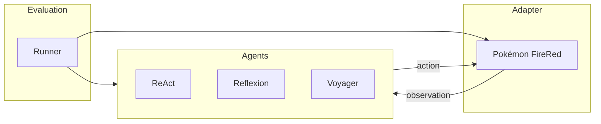

# Porygon

Porygon is an open-source framework for developing and comparing autonomous agents on long-horizon games. The game is Pokémon FireRed. The agents are [ReAct](https://arxiv.org/abs/2210.03629), [Reflexion](https://arxiv.org/abs/2303.11366), and [Voyager](https://voyager.minedojo.org/).

The question is how those architectures change an agent's ability to explore, plan, remember, recover from mistakes, and carry out long action sequences — and which of those mechanisms still help when the game changes.

## Design

Game code, agent code, and experiment code stay separate. A new game is a new adapter. A new architecture is a new agent. Both meet at the same evaluation loop.

### Adapter

The adapter is the only Pokémon-specific code. It owns the emulator, the action space, and saved state. Everything else sees a snapshot.

- `reset()` — start or restore a known state
- `observe()` — return the current snapshot
- `step(action)` — apply one action and return the next snapshot
- `get_progress()` — return progression read from the game

A snapshot is visual (the screen), structured (party, position, battle, inventory, flags, and similar fields read from emulator memory), or both. Those are different experimental conditions, and every run records which one it used.

A goal is an input to the agent. Whether the goal was met is decided from adapter state. The model's own claim does not count.

This split follows the adapter in [Teaching a Local LLM to Play Pokémon Crystal](https://projects.playtesting.dev/posts/pokemon-crystal/): the game lives in one place, and the rest of the system consumes a clean snapshot. FireRed is a Game Boy Advance game, so it does not share that project's emulator.

### Agents

Agents are interchangeable. They receive the goal and observations and return actions. They do not talk to the emulator.

**ReAct.** Reason about the current situation, act, observe, and repeat. This is the baseline.

**Reflexion.** ReAct plus periodic review of failures. The review is stored as text that later decisions can read.

**Voyager.** The lifelong-learning loop from Voyager, retargeted at this environment:

- An **automatic curriculum** proposes the next goal from the agent's progress and state.
- A **skill library** stores behaviors, retrieves them in similar situations, and composes them.
- **Iterative prompting** revises a skill using environment feedback, execution errors, and self-verification against the game.

Voyager's original action space is code, because Minecraft skills are open-ended programs. Pokémon's actions are a closed controller and menu language. The curriculum, library, and feedback loop are the part being adapted. The skill representation is whatever this game can actually execute and reuse.

### Evaluation

A result is a set of repeated trials under one declared configuration: the same initial state, model, action space, observation access, and computational budget.

The runner records task success, game progression, environment steps, token usage and cost, recovery from mistakes, skill reuse on later tasks, and consistency across trials. Ablations turn one mechanism off at a time — the curriculum, the skill library, verbal reflections, or self-verification — and share the runner.

Trajectories, prompts, and model calls are saved with the run.

## Prior work

- [Voyager: An Open-Ended Embodied Agent with Large Language Models](https://voyager.minedojo.org/)
- [ReAct: Synergizing Reasoning and Acting in Language Models](https://arxiv.org/abs/2210.03629)
- [Reflexion: Language Agents with Verbal Reinforcement Learning](https://arxiv.org/abs/2303.11366)
- [Teaching a Local LLM to Play Pokémon Crystal on a DGX Spark](https://projects.playtesting.dev/posts/pokemon-crystal/)

Implementation boundaries for contributors are in [AGENTS.md](AGENTS.md).
